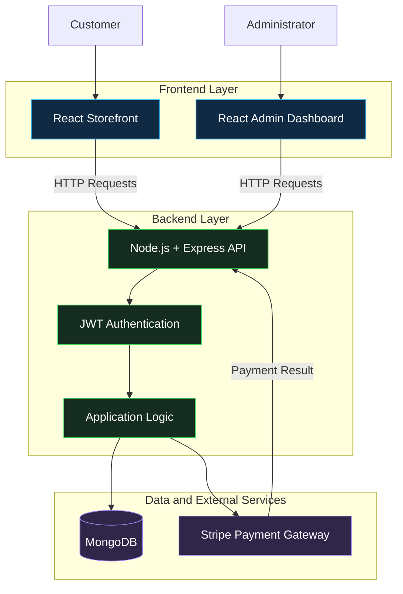
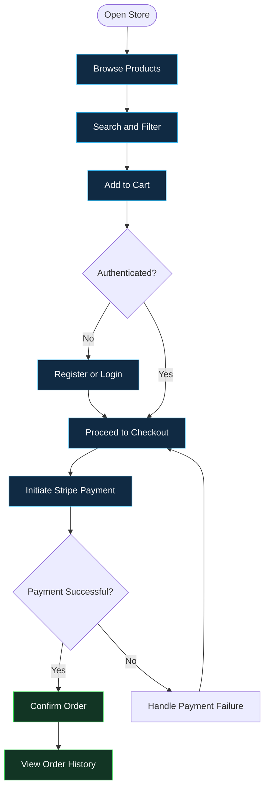
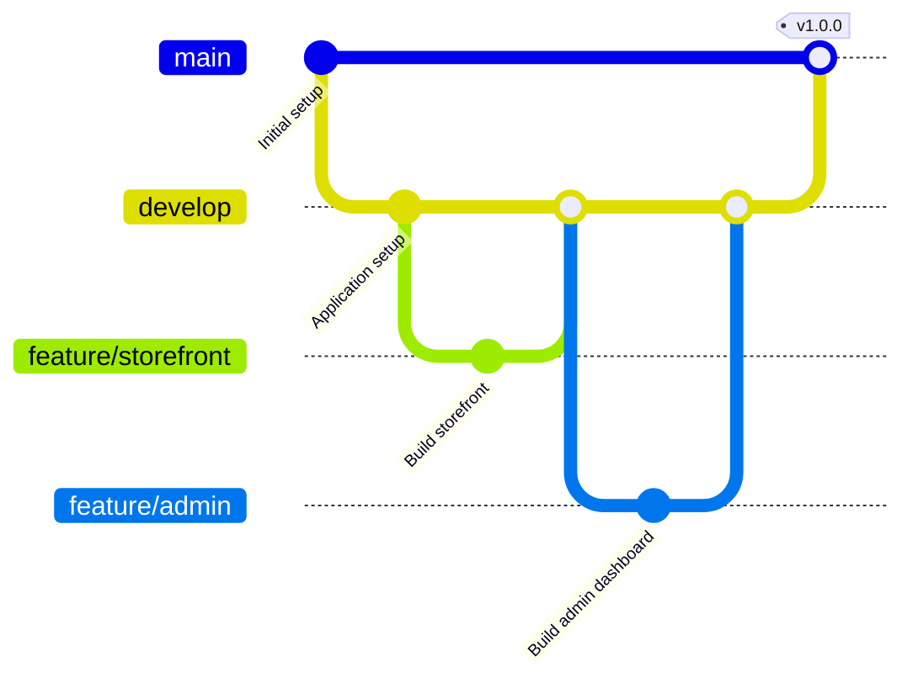

<div align="center">

# 🛒 MERN E-Commerce Platform

### A Full-Stack Shopping Experience with Admin Dashboard

<p>
  
  
  
  
  
</p>

<p>
  
  
  
</p>

**A full-stack e-commerce application built with the MERN stack, featuring a customer storefront, secure authentication, online payments, and a dedicated admin dashboard for managing products, categories, orders, and users.**

<br/>

[Features](#-features) ·
[Architecture](#-system-architecture) ·
[Tech Stack](#-technology-stack) ·
[Installation](#-getting-started) ·
[Git Workflow](#-git-workflow) ·
[Roadmap](#-future-improvements)

</div>

---

## 📑 Table of Contents

- [Overview](#-overview)
- [Features](#-features)
- [System Architecture](#-system-architecture)
- [Application Workflow](#-application-workflow)
- [Technology Stack](#-technology-stack)
- [Project Structure](#-project-structure)
- [Getting Started](#-getting-started)
- [Environment Variables](#-environment-variables)
- [Running the Application](#-running-the-application)
- [Git Workflow](#-git-workflow)
- [Security Considerations](#-security-considerations)
- [Future Improvements](#-future-improvements)
- [Contributing](#-contributing)
- [License](#-license)

---

## 📌 Overview

The **MERN E-Commerce Platform** is a full-stack web application designed to provide an online shopping experience with a separate administrative interface.

The application is organized into three main components:

- **Frontend:** Customer-facing shopping interface.
- **Admin Dashboard:** Interface for managing products, categories, orders, and users.
- **Backend API:** Server-side application responsible for business logic, database operations, authentication, and payment integration.

The project uses MongoDB for data storage, Express.js and Node.js for backend services, React.js for the user interfaces, JWT for authentication, and Stripe for payment processing.

### 🎯 Project Objectives

- Build a complete full-stack web application.
- Implement authentication and protected user functionality.
- Support product discovery and shopping cart operations.
- Integrate online payment processing.
- Provide administrative tools for managing store operations.
- Organize frontend and backend code into maintainable components.

---

## ✨ Features

### 🛍️ Customer Storefront

| Feature | Description |
|---|---|
| 🔐 Authentication | User registration, login, and profile management |
| 🔎 Product Discovery | Browse and search the product catalog |
| 🎯 Product Filtering | Filter products using available catalog options |
| 🛒 Shopping Cart | Add products and update quantities |
| 💳 Online Payments | Stripe payment integration |
| 📦 Order Management | View order history and track order status |
| 👤 User Profile | Manage user account information |

### ⚙️ Admin Dashboard

| Feature | Description |
|---|---|
| 📦 Product Management | Create, update, and delete products |
| 🗂️ Category Management | Organize products into categories |
| 📋 Order Management | View and update order processing status |
| 👥 User Management | Manage users and access levels |
| 🔑 Access Control | Protect administrative functionality |

---

## 🏗️ System Architecture

The following diagram represents the high-level architecture of the application.



> **Architecture note:** This is a conceptual overview based on the documented stack and features, not a verified map of every implemented API or database relationship.

---

## 🔄 Application Workflow

The following diagram illustrates the intended shopping journey.



*This diagram describes the intended flow. The exact checkout, webhook, and order-confirmation implementation should be verified against the backend code.*

---

## 🧰 Technology Stack

<table>
<thead>
<tr>
<th>Layer</th>
<th>Technology</th>
<th>Purpose</th>
</tr>
</thead>
<tbody>
<tr>
<td>Frontend</td>
<td>React.js</td>
<td>Interactive user interfaces</td>
</tr>
<tr>
<td>Backend</td>
<td>Node.js</td>
<td>JavaScript runtime</td>
</tr>
<tr>
<td>API Framework</td>
<td>Express.js</td>
<td>HTTP routes and server logic</td>
</tr>
<tr>
<td>Database</td>
<td>MongoDB</td>
<td>Application data storage</td>
</tr>
<tr>
<td>Authentication</td>
<td>JWT</td>
<td>Token-based authentication</td>
</tr>
<tr>
<td>Payments</td>
<td>Stripe</td>
<td>Payment processing integration</td>
</tr>
</tbody>
</table>

---

## 📁 Project Structure

```text
MERN-Ecommerce/
│
├── admin/                  # React admin dashboard
│   ├── src/
│   ├── public/
│   ├── .env.example        # Recommended environment template
│   └── package.json
│
├── backend/                # Node.js and Express API
│   ├── config/             # If present: configuration
│   ├── controllers/        # If present: request handlers
│   ├── models/             # If present: database models
│   ├── routes/             # If present: API routes
│   ├── middleware/         # If present: middleware
│   ├── server.js           # Confirm against actual project
│   ├── .env.example        # Recommended environment template
│   └── package.json
│
├── frontend/               # React customer storefront
│   ├── src/
│   ├── public/
│   ├── .env.example        # Recommended environment template
│   └── package.json
│
├── .gitignore
└── README.md
```

*Some subdirectories shown above are illustrative. Keep the names in this diagram aligned with your actual repository.*

---

## 🚀 Getting Started

Follow these instructions to run the project locally.

### Prerequisites

Install the following tools:

- [Node.js](https://nodejs.org/) — use a version compatible with the project dependencies.
- [npm](https://www.npmjs.com/) — Node.js package manager.
- [Git](https://git-scm.com/) — version control.
- [MongoDB Atlas](https://www.mongodb.com/atlas) or a local MongoDB instance.
- A Stripe account for payment integration testing.

### 1. Clone the Repository

Replace the example repository URL with your own repository URL if you have forked or published the project under your GitHub account.

```bash
git clone https://github.com/MenathNDGD/MERN-Ecommerce.git
cd MERN-Ecommerce
```

### 2. Install Dependencies

Install dependencies separately in each application directory, assuming each has its own `package.json`.

**Customer frontend**

```bash
cd frontend
npm install
```

**Admin dashboard**

```bash
cd ../admin
npm install
```

**Backend**

```bash
cd ../backend
npm install
```

Return to the project root before following the next steps.

```bash
cd ..
```

---

## 🔐 Environment Variables

Create separate `.env` files in the `frontend`, `admin`, and `backend` directories.

### Frontend — `frontend/.env`

```env
VITE_BACKEND_URL=http://localhost:4000
```

### Admin Dashboard — `admin/.env`

```env
VITE_BACKEND_URL=http://localhost:4000
```

### Backend — `backend/.env`

```env
MONGODB_URI=your_mongodb_connection_string
CLOUDINARY_API_KEY=your_cloudinary_api_key
CLOUDINARY_SECRET_KEY=your_cloudinary_secret
CLOUDINARY_CLOUD_NAME=your_cloudinary_cloud_name
JWT_SECRET=replace_with_a_long_random_secret

ADMIN_EMAIL=your_admin_email
ADMIN_PASSWORD=use_a_strong_unique_password
```

**Important configuration notes:**

- These environment variable names are based on the supplied project documentation. Verify that they match the names read by your code.
- Stripe credentials may also be required. Add the exact payment-related environment variable names used by your backend implementation.
- Never commit real credentials, tokens, database URLs, or passwords.
- The frontend variables prefixed with `VITE_` are exposed to client-side code. Never place private API secrets in them.
- The project description mentions Stripe, while the supplied environment-variable list does not include Stripe keys. Verify the backend payment configuration before running checkout.
- The original README mentioned Appwrite credentials, but the documented stack uses MongoDB and Cloudinary. Use the credentials required by your actual code.

---

## ▶️ Running the Application

Open **three separate terminals** from the project root.

### Terminal 1 — Backend

```bash
cd backend
npm run server
```

This command assumes the backend `package.json` defines a `server` script. If it does not, use the script listed in that file.

### Terminal 2 — Customer Frontend

```bash
cd frontend
npm run dev
```

### Terminal 3 — Admin Dashboard

```bash
cd admin
npm run dev
```

### Local Development URLs

| Component | URL |
|---|---|
| Customer storefront | `http://localhost:5173` |
| Admin dashboard | `http://localhost:5174` |
| Backend | `http://localhost:4000` |

These frontend ports reflect the original README. Vite can choose a different port if the configured port is unavailable. The backend URL assumes the server is configured to listen on port `4000`.

---

## 🌿 Git Workflow

A simple branch workflow can help keep the project organized when working alone or with collaborators.



### Suggested Branch Naming

| Branch | Purpose |
|---|---|
| `main` | Stable code |
| `develop` | Integration branch |
| `feature/storefront` | Storefront features |
| `feature/admin` | Admin dashboard features |
| `fix/payment-flow` | Payment-related bug fixes |

### Example Commands

```bash
git switch -c feature/storefront
git add .
git commit -m "feat: improve product storefront"
git push -u origin feature/storefront
```

Open a pull request to merge the branch after reviewing and testing your changes.

---

## 🔒 Security Considerations

- Keep `.env` files out of version control.
- Use strong, unique secrets for JWT signing.
- Enforce authorization on the backend for administrative operations.
- Validate request payloads before updating database records.
- Verify payment status on the server rather than trusting client-side success messages.
- Use Stripe's recommended server-side payment verification and webhook handling where applicable.
- Avoid storing raw payment-card information in your application database.
- Never publish working admin credentials in documentation.

### Recommended `.gitignore` Entries

```gitignore
node_modules/
.env
.env.*
!.env.example
dist/
build/
coverage/
.DS_Store
npm-debug.log*
```

Review existing ignore rules before changing them, particularly if the project already has environment templates.

---

## 🗺️ Future Improvements

Potential improvements for future versions:

- [ ] Add product reviews and ratings.
- [ ] Add wishlist functionality.
- [ ] Improve product pagination and filtering.
- [ ] Add automated tests for API routes.
- [ ] Add centralized error handling and structured logging.
- [ ] Add CI checks with GitHub Actions.
- [ ] Add deployment documentation.
- [ ] Add screenshots and a live demo link.
- [ ] Improve accessibility and responsive layouts.

*These are suggested improvements, not claims about features already implemented.*

---

## 🤝 Contributing

Contributions and suggestions are welcome.

1. Fork the repository.
2. Create a feature branch.
3. Implement and test your changes.
4. Commit your work with a descriptive message.
5. Open a pull request with a clear summary.

---

## 📄 License

Add the license used by your project here. If the repository does not currently contain a license, choose one before specifying reuse permissions.

---

<div align="center">

**Built with ❤️ using the MERN stack**

[GitHub Profile](https://github.com/GauravRaj25) · [Email](mailto:gauravraj954647@gmail.com)

</div>
